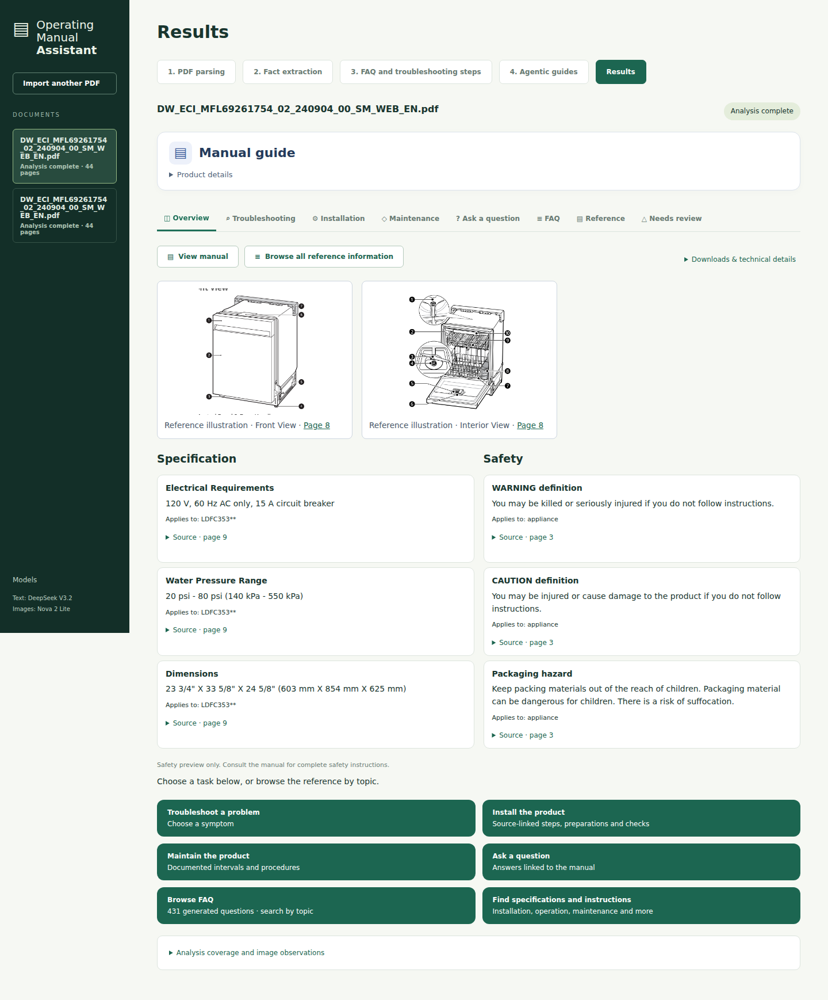
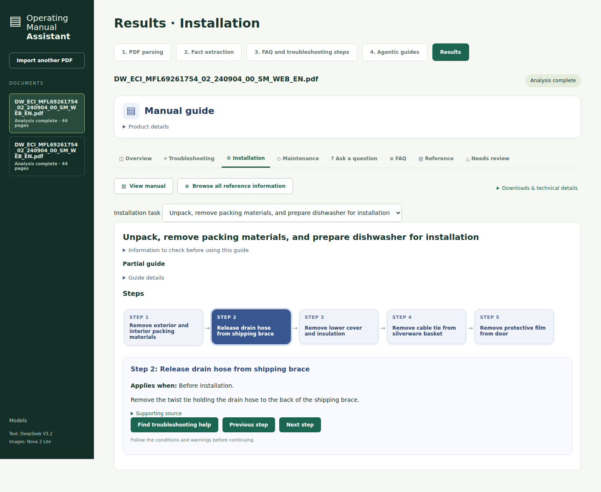
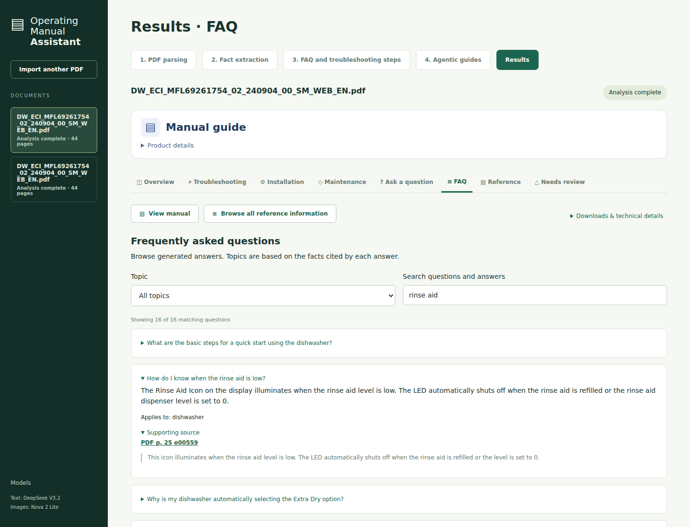
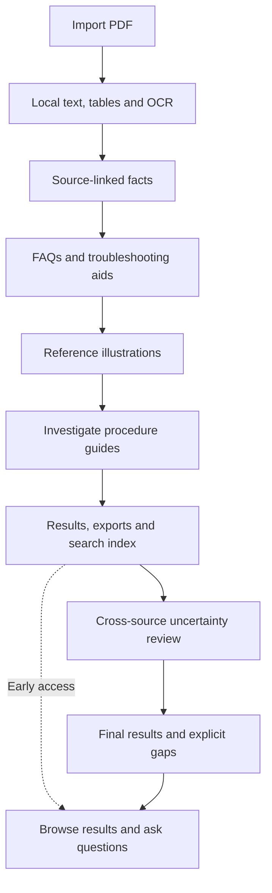
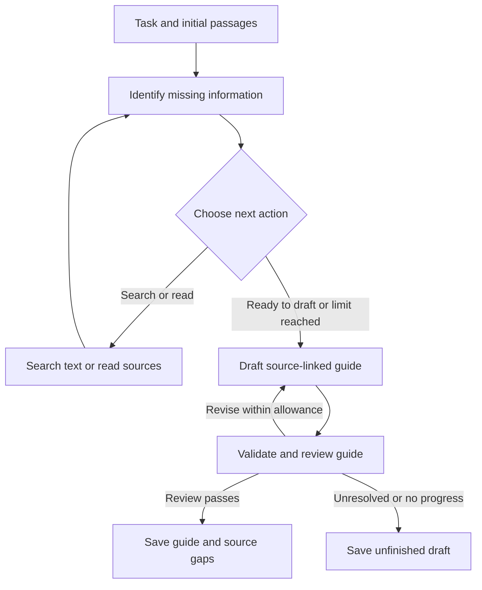

# Operating Manual Assistant

An agentic AI project that turns a PDF operating manual into an interactive,
source-linked reference: installation walkthroughs, maintenance procedures,
troubleshooting guides, searchable FAQs, and answers that point back to the manual.

Instead of stopping at a document summary, the application investigates individual
tasks, assembles practical guides, and reviews them against the original passages.
Readers can follow a step flow, inspect a supporting quotation, or open the cited
PDF page. Missing instructions and unresolved questions remain visible.


## What it does

- **Read manuals:** extract text, tables and page references, with local OCR where needed.
- **Follow installation procedures:** choose a task, navigate its step flow, and see
  prerequisites, conditions, warnings and completion checks.
- **Plan maintenance:** browse source-supported procedures and documented intervals.
- **Troubleshoot:** explore supported decision branches, guided chat and independent checks.
- **Find answers:** filter FAQs by topic, search their questions and answers, or ask
  a question answered from retrieved manual passages.
- **Inspect and export:** open original source pages, review uncertainties, and download
  HTML reports, JSON data and CSV facts.
- **Resume saved work:** retain completed tasks and model-call records across bounded
  pauses; recheck blocked guides without repeating PDF extraction.

The browser, parsing, saved files and search index run locally. Model requests send
selected passages—and selected reference images when applicable—to the configured
provider. This is not an entirely offline application.

## Screenshots

Real application views from a completed dishwasher-manual analysis. The screenshots
show generated material, including its visible limitations, rather than mocked-up data.

### Overview

Source-linked specifications, safety information, original reference illustrations,
and shortcuts to the main tasks.



### Installation

An interactive step flow with the current instruction, supporting sources and
Previous/Next buttons. The example shows step two of an unpacking guide.



### FAQ

Search generated questions and answers, filter by topic, and expand the original
passage behind an answer.



## How the system works

**Application code controls the overall workflow. Models make bounded decisions
inside it.** Successful parsing starts the first analysis automatically; opening a
saved result does not start another analysis.



The most agentic part is **procedure investigation**. Each installation, maintenance
or troubleshooting task has its own saved investigation. The planner chooses what
to inspect next instead of receiving one fixed excerpt and producing a one-shot guide.



Repeated inspections and unchanged rejected drafts do not run indefinitely. When
exploration stops making progress, the planner switches to drafting from the evidence
already collected. A finish proposal is not approval: the draft still goes through
source checks and model review.

### Agentic components and application responsibilities

| Component | What the model does | What application code controls |
| --- | --- | --- |
| Task discovery and organization | Identifies manual-supported tasks, combines overlapping leads and associates prerequisites. | Preserves source references and accounts for leads that remain unassigned. |
| Procedure planner | Chooses source searches/reads, tracks unanswered questions and proposes or revises a guide. | Runs only allowed inspection actions, saves evidence and progress, and bounds work. |
| Guide reviewer | Checks relevance, coverage, source support and stated evidence gaps. A focused follow-up asks whether negative findings require a concrete change. | Validates reply structure and source references, retains the audit, and prevents unresolved review from becoming approval. |
| Uncertainty investigation | Proposes ambiguities and checks them against additional source groups. | Schedules cross-source checks and retains unresolved findings for the reader. |
| Fact, FAQ and issue-specific tree generation | Produces structured content from supplied source groups. | Uses fixed workflow stages; these tasks are not autonomous source-inspection loops. |
| Question answering | Answers from retrieved passages or reports insufficient evidence. | Searches the local index, validates citations and links related guides; it does not rerun the planner. |

A reviewer is a separate model call, not a human reviewer or necessarily a different
model. The application owns passage IDs, original quotations and page references;
models select supporting passages rather than manufacture citation bookkeeping.
Independent work can run concurrently, while dependent inspection and revision steps
stay ordered.

### Evidence, progress and recovery

- **Traceable output:** source links connect generated text to original manual passages.
- **Inspectable work:** saved requests, replies and usage records show which evidence
  a model received and what it returned.
- **Bounded processing:** call/input allowances, output limits and saved checkpoints
  keep work finite. Compatible completed responses can be reused on explicit Resume.
- **Targeted recovery:** unresolved guides can be rechecked and revised through the
  normal planner and publisher while accepted guides remain intact.
- **Visible limits:** a finished guide can still contain unanswered source questions.
  Citation matching and model review do not independently establish correctness,
  completeness or safety. Image-dependent procedure gaps may remain unresolved.

Standalone diagrams: [system flow](docs/images/system-flow.svg) ·
[agent investigation loop](docs/images/agent-investigation-loop.svg).

For implementation details, start with the
[workflow entry point](backend/src/workbench/agentic_workflow/run_manual_analysis.py),
[procedure planner](backend/src/workbench/procedure_guides/plan_source_linked_procedures.py),
[current guide reviewer](backend/src/workbench/procedure_guides/review_guide_with_separate_jobs.py),
and [review recovery](backend/src/workbench/procedure_guides/repair_unresolved_manual_guides.py).

## Technology stack

| Layer | Technology | Purpose |
| --- | --- | --- |
| Application server | Python 3.12, FastAPI, Uvicorn | Serve the local interface and coordinate background analysis. |
| Browser interface | Native JavaScript modules, HTML, CSS | Interactive guides, diagrams, search and progress without a frontend build step. |
| PDF reading | Docling, PyTorch, pypdfium2, Pillow | Extract text and tables, recognize scanned text, render pages and crop original figures. |
| Model access | Amazon Bedrock through Boto3 | Text generation and selective image assessment behind a provider-independent interface. |
| Current model configuration | DeepSeek V3.2; Nova 2 Lite | Text reasoning and reference-image assessment respectively. Model access depends on the configured AWS region and account. |
| Structured responses | Pydantic, JSON Schema | Validate required reply fields and allowed decisions before using generated content. |
| Local search | ChromaDB | Store searchable manual passages and retrieve evidence for questions. |
| Reports and configuration | Jinja2, python-dotenv | Generate HTML reports and read private local model settings. |
| Development checks | pytest, HTTPX, Playwright, Ruff, Prettier | Offline application tests, browser inspection and code-formatting tools. |

The workflow is implemented directly in Python. Procedure agents can choose allowed
searches and reads; they do not execute arbitrary generated code. Only the Bedrock
provider has been exercised live in this project. New provider implementations can
use the same request and response interface.

## Run locally

The application has been exercised on Linux with Python 3.12 and CPU-only PyTorch.
Run these commands from the cloned repository:

```bash
python3.12 -m venv .venv
source .venv/bin/activate
python -m pip install --upgrade pip
python -m pip install torch==2.15.0+cpu torchvision==0.29.2+cpu --index-url https://download.pytorch.org/whl/cpu
python -m pip install -r requirements.txt
cp .env.example .env
```

For an existing checkout, keep your current `.env` rather than copying over it.
Edit `.env` to supply your Bedrock API key, AWS region and permitted model IDs.
Then start the local server:

```bash
./run.sh
```

Open **http://127.0.0.1:8786/**. Keep the server bound to localhost unless you add
appropriate access controls. Node.js is not required to run the application.
OCR, layout and embedding models may download on first use. Uploading a usable
manual starts its first bounded analysis and can incur model-provider charges.

[requirements.txt](requirements.txt) pins direct runtime dependencies to the tested
application environment and installs the local Python package. PyTorch is installed
separately above to select CPU wheels. The repository's `frontend/` directory must
remain beside `backend/`; this is a full-checkout application, not a backend-only wheel.

### Run the offline tests

```bash
python -m pip install -r requirements-dev.txt
python -m pytest -q
```

The distributed tests use temporary storage and controlled model responses, with
live Bedrock connections blocked. Private experiment snapshots and tests that depend
on them are not included. See [test documentation](backend/tests/README.md).

### What stays local

Uploaded PDFs, extracted text, search collections, generated reports and model-call
records are written under ignored `data/`. Credentials belong in ignored `.env`.
Neither is part of this repository. Source passages sent for AI analysis are processed
by the configured model provider; local storage does not make those requests offline.

## Read the code

Start with the [code guide](CODE_GUIDE.md), then the package READMEs:

- [Backend](backend/README.md): document processing, AI work, storage and browser requests.
- [Frontend](frontend/README.md): navigation, display and downloadable report templates.
- [Model access](backend/src/workbench/model_access/README.md): provider connections and reply handling.
- [Guide investigations](backend/src/workbench/procedure_guides/README.md): task discovery, inspections, drafting and review.

## Processing limits

Run and Resume each authorize a bounded work slice. Completed batches survive pauses;
there is no total-document character cutoff. The UI shows actual token usage and
labelled rough extraction estimates. Existing upload bounds remain 80 pages/25 MiB.
Reloading or opening a job does not start paid work. See the code guide for exact
request and continuation allowances.

Source quotations are checked, not independently verified. Generated diagnostic
instructions and safety interpretations require review. Older saved jobs remain
available but do not acquire newly introduced outputs without new analysis.

See [model access](backend/src/workbench/model_access/README.md) for the provider-independent interface and model-specific output allowances. Output-limited fact/ambiguity/FAQ/tree requests are divided into smaller source groups; failed attempts remain in the audit log.
