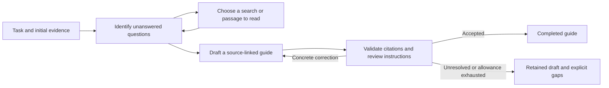

# Operating Manual Assistant

An agentic AI project that turns a PDF operating manual into an interactive,
source-linked reference: installation walkthroughs, maintenance procedures,
troubleshooting guides, searchable FAQs, and answers that point back to the manual.

Instead of summarizing the manual in one pass, agents investigate individual tasks:
they identify missing information, choose what to read next, check proposed instructions
against the source, and revise them using review feedback.

## What it does

- **Read manuals:** extract text, tables and page references, with local OCR where needed.
- **Follow installation procedures:** choose a task, navigate its step flow, and see
  prerequisites, conditions, warnings and completion checks.
- **Plan maintenance:** browse source-supported procedures and documented intervals.
- **Troubleshoot:** explore supported decision branches, guided chat and independent checks.
- **Find answers:** filter FAQs by topic, search their questions and answers, or ask
  a question answered from retrieved manual passages.
- **Inspect and export:** open original source pages, review uncertainties, and download
  HTML reports, JSON results, and CSV lists of parts and maintenance facts.
- **Resume saved work:** retain completed tasks and model-call records across bounded
  pauses; recheck blocked guides without repeating PDF extraction.

The browser, parsing, saved files and search index run locally. Model requests send
selected passages—and selected reference images when applicable—to the configured
provider. This is not an entirely offline application.

## How the agents investigate

Each installation, maintenance or troubleshooting task gets its own investigation.
The agent tracks unanswered questions, searches the manual, reads relevant passages
and neighbouring pages, then decides whether it has enough evidence to draft a guide.
It can follow up on missing prerequisites, warnings, conditions and completion checks
without the reader directing each search.

### Why separate investigation, drafting and review?

The system is designed around a lower-cost model, not the assumption that one large
prompt will produce a reliable manual. A model can miss instructions, invent details,
or lose track of evidence when asked to do everything at once. Narrow steps give it
one decision to make at a time:

- **Investigate before drafting:** gather missing context instead of filling gaps by guessing.
- **Validate with code:** check response structure, source references and exact quotations.
- **Review distinct questions:** does a passage apply, is its instruction preserved, and
  does the source support the guide's claims?
- **Challenge objections and revise:** check whether a negative finding requires a concrete
  change, then give the writer focused corrections rather than restarting the whole task.

These checks reduce reliance on a single model answer; they do not guarantee correctness.
The agents test claims against the manual—not the physical product. Code limits calls,
saves progress and stops repeated unproductive work; exhausted reviews are not approval.
See [architecture and agent responsibilities](docs/architecture.md) for the full workflow.

## Screenshots

Real views from a completed dishwasher-manual analysis.

### Overview

Specifications, safety information and original reference illustrations, linked to the source.

### Installation

A source-linked step flow with instructions and Previous/Next navigation.

## Technology stack

| Layer | Technology | Purpose |
| --- | --- | --- |
| Application server | Python 3.12, FastAPI, Uvicorn | Serve the local interface and coordinate background analysis. |
| Browser interface | Native JavaScript modules, HTML, CSS | Interactive guides, diagrams, search and progress without a frontend build step. |
| PDF reading | Docling, PyTorch, pypdfium2, Pillow | Extract text and tables, recognize scanned text, render pages and crop original figures. |
| Model access | Amazon Bedrock through Boto3 | Text generation and selective image assessment behind a provider-independent interface. |
| Current model configuration | DeepSeek V3.2; Nova 2 Lite | Text reasoning and reference-image assessment respectively. Model access depends on the configured AWS region and account. |
| Structured responses | Pydantic, JSON Schema | Validate required reply fields and allowed decisions before using generated content. |
| Local search | ChromaDB | Store searchable manual passages and retrieve evidence for questions. |
| Reports and configuration | Jinja2, python-dotenv | Generate HTML reports and read private local model settings. |
| Development checks | pytest, HTTPX, Playwright, Ruff, Prettier | Offline application tests, browser inspection and code-formatting tools. |

The workflow is implemented directly in Python. Procedure agents can choose allowed
searches and reads; they do not execute arbitrary generated code. Only the Bedrock
provider has been exercised live in this project. New provider implementations can
use the same request and response interface.

## Get started

Use Python 3.12 on Linux and a Bedrock account with access to your configured models.
Follow the [installation and configuration guide](docs/setup.md), then run `./run.sh`
and open **http://127.0.0.1:8786/**. The frontend needs no build step.

## Try a sample manual

Upload the [Mk II Laser Blaster demo PDF](examples/mk-ii-laser-blaster/manual.pdf):
a fictional training product with battery installation, a manual safety, human-contact
and low-power interlocks, cleaning, and troubleshooting. In a live DeepSeek V3.2 run,
all five planned guides completed automated review; two retained unanswered-information
notes. [Test details and limitations](examples/mk-ii-laser-blaster/README.md).

## Development

- [Code guide](CODE_GUIDE.md): where to start reading.
- [Backend](backend/README.md) and [frontend](frontend/README.md): package responsibilities.
- [Tests](backend/tests/README.md): offline checks and their limits.
- [Runtime requirements](requirements.txt) and [development requirements](requirements-dev.txt).

GitHub Actions runs offline tests and targeted error linting on pushes and pull requests.
Changes are kept in focused commits.

## Data and limitations

Credentials stay in ignored `.env`; uploaded manuals, generated reports and request
records stay in ignored `data/`. Selected passages and images are sent to the configured
model provider. Uploads currently allow 80 pages / 25 MiB. Generated instructions and
safety interpretations need review; citations do not independently prove correctness.

## License

A project-wide license has not yet been selected. Do not assume permission to reuse
or redistribute the project merely because its repository is visible to you.
