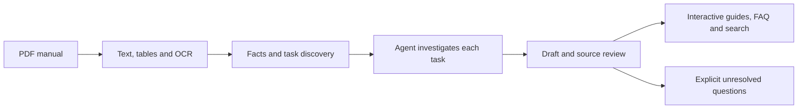

# Operating Manual Assistant

An agentic AI project that turns a PDF operating manual into an interactive,
source-linked reference: installation walkthroughs, maintenance procedures,
troubleshooting guides, searchable FAQs, and answers that point back to the manual.

Instead of stopping at a document summary, the application investigates individual
tasks, assembles practical guides, and reviews them against the original passages.
Readers can follow a step flow, inspect a supporting quotation, or open the cited
PDF page. Missing instructions and unresolved questions remain visible.

## What it does

- **Read manuals:** extract text, tables and page references, with local OCR where needed.
- **Follow installation procedures:** choose a task, navigate its step flow, and see
  prerequisites, conditions, warnings and completion checks.
- **Plan maintenance:** browse source-supported procedures and documented intervals.
- **Troubleshoot:** explore supported decision branches, guided chat and independent checks.
- **Find answers:** filter FAQs by topic, search their questions and answers, or ask
  a question answered from retrieved manual passages.
- **Inspect and export:** open original source pages, review uncertainties, and download
  HTML reports, JSON data and CSV facts.
- **Resume saved work:** retain completed tasks and model-call records across bounded
  pauses; recheck blocked guides without repeating PDF extraction.

The browser, parsing, saved files and search index run locally. Model requests send
selected passages—and selected reference images when applicable—to the configured
provider. This is not an entirely offline application.

## Screenshots

Real application views from a completed dishwasher-manual analysis. The screenshots
show generated material, including its visible limitations, rather than mocked-up data.

### Overview

Source-linked specifications, safety information, original reference illustrations,
and shortcuts to the main tasks.

### Installation

An interactive step flow with the current instruction, supporting sources and
Previous/Next buttons. The example shows step two of an unpacking guide.

### FAQ

Search generated questions and answers, filter by topic, and expand the original
passage behind an answer.

## Workflow

The application controls budgets, saved progress, evidence and completion. Procedure
agents choose which passages to inspect and revise drafts using review feedback.
Reviews are model checks, not human verification; unresolved findings remain visible.
See [architecture and agent responsibilities](docs/architecture.md).

## Technology stack

| Layer | Technology | Purpose |
| --- | --- | --- |
| Application server | Python 3.12, FastAPI, Uvicorn | Serve the local interface and coordinate background analysis. |
| Browser interface | Native JavaScript modules, HTML, CSS | Interactive guides, diagrams, search and progress without a frontend build step. |
| PDF reading | Docling, PyTorch, pypdfium2, Pillow | Extract text and tables, recognize scanned text, render pages and crop original figures. |
| Model access | Amazon Bedrock through Boto3 | Text generation and selective image assessment behind a provider-independent interface. |
| Current model configuration | DeepSeek V3.2; Nova 2 Lite | Text reasoning and reference-image assessment respectively. Model access depends on the configured AWS region and account. |
| Structured responses | Pydantic, JSON Schema | Validate required reply fields and allowed decisions before using generated content. |
| Local search | ChromaDB | Store searchable manual passages and retrieve evidence for questions. |
| Reports and configuration | Jinja2, python-dotenv | Generate HTML reports and read private local model settings. |
| Development checks | pytest, HTTPX, Playwright, Ruff, Prettier | Offline application tests, browser inspection and code-formatting tools. |

The workflow is implemented directly in Python. Procedure agents can choose allowed
searches and reads; they do not execute arbitrary generated code. Only the Bedrock
provider has been exercised live in this project. New provider implementations can
use the same request and response interface.

## Get started

Use Python 3.12 on Linux and a Bedrock account with access to your configured models.
Follow the [installation and configuration guide](docs/setup.md), then run `./run.sh`
and open **http://127.0.0.1:8786/**. The frontend needs no build step.

For a no-key example, inspect the [fictional demonstration](examples/README.md):
original PDF, parsed passages and generated results from controlled model replies.
It exercises the real analysis workflow but is **not a live AI benchmark**.

## Development

- [Code guide](CODE_GUIDE.md): where to start reading.
- [Backend](backend/README.md) and [frontend](frontend/README.md): package responsibilities.
- [Tests](backend/tests/README.md): offline checks and their limits.
- [Runtime requirements](requirements.txt) and [development requirements](requirements-dev.txt).

GitHub Actions runs offline tests, targeted error linting and demo generation on pushes
and pull requests. Changes are kept in focused commits; the original private workspace
history is intentionally not published.

## Data and limitations

Credentials stay in ignored `.env`; uploaded manuals, generated reports and request
records stay in ignored `data/`. Selected passages and images are sent to the configured
model provider. Uploads currently allow 80 pages / 25 MiB. Generated instructions and
safety interpretations need review; citations do not independently prove correctness.

## License

A project-wide license has not yet been selected. Do not assume permission to reuse
or redistribute the project merely because its repository is visible to you.
