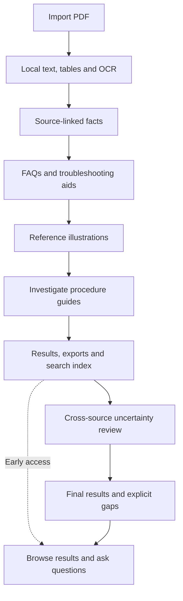
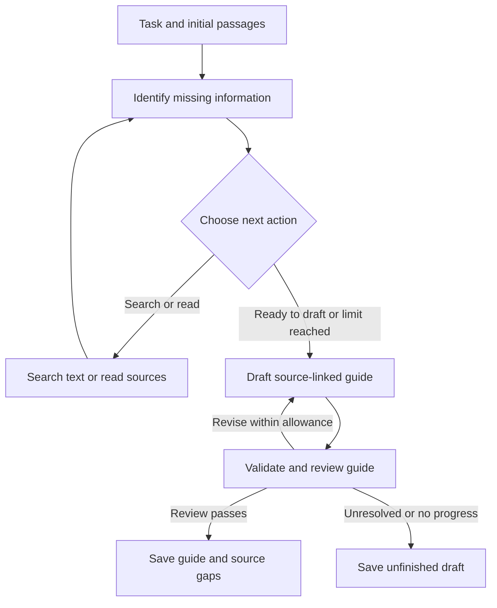

# Architecture

**Application code controls the overall workflow. Models make bounded decisions
inside it.** Successful parsing starts the first analysis automatically; opening a
saved result does not start another analysis.

The most agentic part is **procedure investigation**. Each installation, maintenance
or troubleshooting task has its own saved investigation. The planner chooses what
to inspect next instead of receiving one fixed excerpt and producing a one-shot guide.

Repeated inspections and unchanged rejected drafts do not run indefinitely. When
exploration stops making progress, the planner switches to drafting from the evidence
already collected. A finish proposal is not approval: the draft still goes through
source checks and model review.

### Agentic components and application responsibilities

| Component | What the model does | What application code controls |
| --- | --- | --- |
| Task discovery and organization | Identifies manual-supported tasks, combines overlapping leads and associates prerequisites. | Preserves source references and accounts for leads that remain unassigned. |
| Procedure planner | Chooses source searches/reads, tracks unanswered questions and proposes or revises a guide. | Runs only allowed inspection actions, saves evidence and progress, and bounds work. |
| Guide reviewer | Checks relevance, coverage, source support and stated evidence gaps. A focused follow-up asks whether negative findings require a concrete change. | Validates reply structure and source references, retains the audit, and prevents unresolved review from becoming approval. |
| Uncertainty investigation | Proposes ambiguities and checks them against additional source groups. | Schedules cross-source checks and retains unresolved findings for the reader. |
| Fact, FAQ and issue-specific tree generation | Produces structured content from supplied source groups. | Uses fixed workflow stages; these tasks are not autonomous source-inspection loops. |
| Question answering | Answers from retrieved passages or reports insufficient evidence. | Searches the local index, validates citations and links related guides; it does not rerun the planner. |

A reviewer is a separate model call, not a human reviewer or necessarily a different
model. The application owns passage IDs, original quotations and page references;
models select supporting passages rather than manufacture citation bookkeeping.
Independent work can run concurrently, while dependent inspection and revision steps
stay ordered.

### Evidence, progress and recovery

- **Traceable output:** source links connect generated text to original manual passages.
- **Inspectable work:** saved requests, replies and usage records show which evidence
  a model received and what it returned.
- **Bounded processing:** call/input allowances, output limits and saved checkpoints
  keep work finite. Compatible completed responses can be reused on explicit Resume.
- **Targeted recovery:** unresolved guides can be rechecked and revised through the
  normal planner and publisher while accepted guides remain intact.
- **Visible limits:** a finished guide can still contain unanswered source questions.
  Citation matching and model review do not independently establish correctness,
  completeness or safety. Image-dependent procedure gaps may remain unresolved.

Standalone diagrams: [system flow](images/system-flow.svg) ·
[agent investigation loop](images/agent-investigation-loop.svg).

For implementation details, start with the
[workflow entry point](../backend/src/workbench/agentic_workflow/run_manual_analysis.py),
[procedure planner](../backend/src/workbench/procedure_guides/planner.py),
[current guide reviewer](../backend/src/workbench/procedure_guides/reviewer.py),
and [review recovery](../backend/src/workbench/procedure_guides/repair_unresolved_manual_guides.py).

## Inspecting state and review decisions

The planner uses a typed `PlannerState` dictionary so existing JSON checkpoints remain
readable. Its state helpers initialize progress, close exploration in one direction,
and apply completed reviews. The planner still owns dispatch, persistence and budgets.

The reviewer delegates prompt/response definitions to `review_jobs.py`, lossless
request splitting to `review_batches.py`, and correction recording to `review_audit.py`.
Model prompts and response schemas are unchanged by this decomposition.

Internal evidence, task and document types live in
[application_types.py](../backend/src/workbench/data_models/application_types.py).
These annotations document boundaries; they do not replace runtime validation or
constitute a fully statically checked codebase. Model-provider replies already use
the shared `Result` dataclass, while validated review outcomes use Pydantic.
